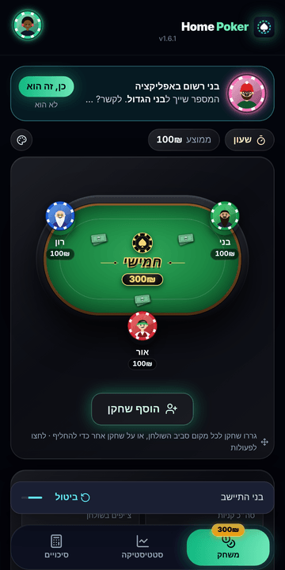
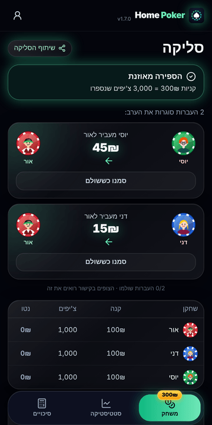
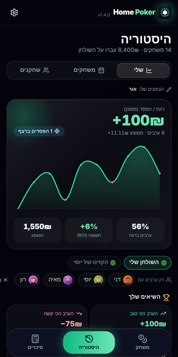
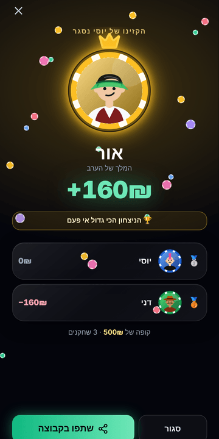
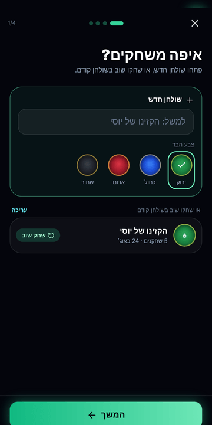
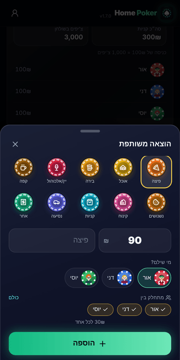
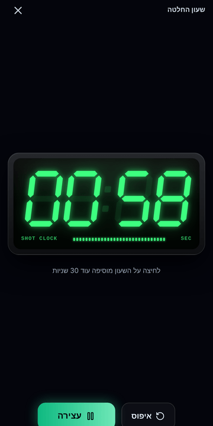
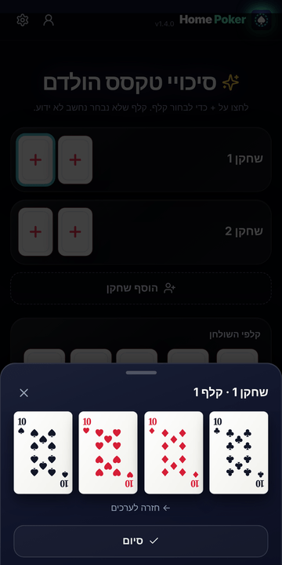

<div dir="rtl">

# 🃏 Home Poker

**מנהלים ערב פוקר ביתי מהטלפון: קניות, ספירת צ'יפים, סליקה בכמה שפחות העברות, שידור חי לחברים וסטטיסטיקה אישית לאורך זמן.**

**באוויר:** https://home-poker-il.netlify.app · **[English](README.md)**

---

Home Poker היא אפליקציית ווב (PWA) לניהול ערבי פוקר בין חברים. אפשר להתקין אותה בטלפון כמו אפליקציה רגילה, והיא עובדת גם בלי אינטרנט ובלי משתמש. היא רושמת קניות וקניות נוספות, בודקת שספירת הצ'יפים מסתדרת, מחשבת מי משלם למי בכמה שפחות העברות, משדרת את השולחן בזמן אמת לחברים שלא הגיעו, ובונה לכל שחקן סטטיסטיקה לאורך זמן. היא בנויה קודם כל לעברית, מימין לשמאל ולטלפון.

<p align="center">
  
  
  
  
</p>
<p align="center">
  
  
  
  
</p>

## תוכן העניינים

- [פיצ'רים](#פיצרים)
- [איך זה בנוי](#איך-זה-בנוי)
- [מבנה הקוד](#מבנה-הקוד)
- [הרצה מקומית](#הרצה-מקומית)
- [העלאה לאוויר](#העלאה-לאוויר)
- [הקמת הענן (Supabase)](#הקמת-הענן-supabase)
- [התראות לטלפון](#התראות-לטלפון)
- [פרטיות ואבטחה](#פרטיות-ואבטחה)
- [אנליטיקס](#אנליטיקס)
- [שחרור גרסה חדשה](#שחרור-גרסה-חדשה)

## פיצ'רים

**בשולחן**
- **שולחנות במקום קבוצות:** כל ערב שייך לשולחן עם שם וצבע בד משלו (ירוק, כחול, אדום או שחור). "שחק שוב" מושיב את אותם שחקנים עם אותה כניסה בלחיצה אחת. כשפותחים שולחן חדש, האפליקציה מציעה את השחקנים מהערב האחרון.
- **שחקנים:** לכל שחקן יש דמות ומסגרת בצורת צ'יפ קזינו. גוררים שחקנים מסביב לשולחן כדי להחליף מקומות. ערימת שטרות גדלה, ודמות שמזיעה, מראות מי קנה הכי הרבה.
- **קניות וקניות נוספות** עם גלגלת בחירה, ממוצע הכניסות בשולחן, ו**יומן ערב** מלא: מי התיישב, כל קנייה נוספת, מי קם ומי שילם על הפיצה.
- **ביטול:** כל פעולה בשולחן (קנייה, הסרה, הזזה, הוצאה) אפשר לבטל במשך 5 שניות.
- **בחירה מאנשי הקשר:** שם וטלפון ישר מחלון אנשי הקשר של הטלפון (באנדרואיד בכרום).
- **שעון החלטה:** שעון LED ירוק במסך מלא, עם גלגלת לבחירת הזמן. לחיצה עליו מוסיפה עוד זמן מלא, הוא מתקתק ב-5 השניות האחרונות, וזמזם נשמע באפס.
- **מחשבון סיכויים:** סיכויי טקסס הולדם בסימולציית מונטה קרלו (60,000 חלוקות), עם קלפים שנראים אמיתיים ובחירה בשתי לחיצות: ערך ואז צורה.

**סגירת הערב**
- **ספירת צ'יפים** עם פס שמראה כמה נשאר לספור, ובדיקה שהסכום מתאזן לאפס. ברגע שכל הצ'יפים נספרו, מי שלא נספר מקבל 0 אוטומטית.
- **סליקה:** אלגוריתם חמדני שסוגר את כולם עם לכל היותר *n − 1* העברות, עם סימון "שולם" לכל העברה. הודעת הסיכום לוואטסאפ כוללת את כל ההעברות ואת מספרי הטלפון של הזוכים, להעברה בביט או בפייבוקס.
- **חשבון משותף (זוגות):** שחקנים שחולקים כיס נשארים עם מקום, קניות וסטטיסטיקה נפרדים, אבל בסליקה הם גוף אחד ("דני & דנה"), ולכן לא מעבירים כסף אחד לשני.
- **הוצאות משותפות** (פיצה, שתייה, נשנושים ועוד) עם אייקונים בסגנון צ'יפים. מי ששילם מקבל, והשאר מתחלקים. ההוצאות נכנסות להעברות, אבל לא לסטטיסטיקת הפוקר.
- **מסך המנצח** עם פודיום, שיאים שנשברו ("הניצחון הכי גדול אי פעם", "3 ניצחונות ברצף") וכפתור שיתוף.
- **תזכורת עדינה לסגור את הערב** כשמשחק פתוח יותר מ-8 שעות.

**חברים וסטטיסטיקה**
- **קישור צפייה בשידור חי:** דף לצפייה בלבד שמתעדכן אחרי כל שינוי, עם הזמנה להירשם. הוא עובד גם בלי אינטרנט, כקישור "תמונת מצב" שהמצב שמור בתוכו.
- **דשבורד אישי:** גרף רווח/הפסד (ירוק מעל האפס, אדום מתחת), סינון מהיר לפי שולחן ולפי יריב, שיאים אישיים, וראש בראש עם מדד חפיפה ותגיות חכמות ("הכספומט שלך", "קריפטונייט", "הכריש" ועוד).
- **היסטוריה:** שינוי שם לערבים ולשולחנות, העברת ערב לשולחן אחר, ומחיקה של כמה ערבים בבת אחת.

**ענן (Supabase, לא חובה)**
- התחברות עם Google, ודמות וצבע זוהר שכולם רואים. שולחנות משותפים עם קוד הזמנה וטבלת מובילים.
- כל ערב שנשמר כשמחוברים נכנס אוטומטית לסטטיסטיקה של כולם.
- **קישור לפי טלפון:** כשמארח מושיב שחקן רשום לפי המספר שלו, המושב מקבל את הדמות ואת הסטטיסטיקה שלו, והוא מקבל הזמנה לשידור החי. מי שנרשם אחר כך לוחץ "זה אני", והערבים הקודמים שלו עוברים אליו.
- **הזמנות:** חלון בתוך האפליקציה כשהושיבו אותך במשחק חי, וגם התראות Web Push.
- **גיבוי המשחק הפתוח:** אם הטלפון של המארח נכבה, אפשר לשחזר את הערב מכל מכשיר.

## איך זה בנוי

| שכבה | מה נבחר | למה |
|---|---|---|
| ממשק | React 18 + Vite 5 | בנייה מהירה ומבנה רכיבים פשוט |
| עיצוב | Tailwind CSS 3, גופן Rubik | עובד טוב מימין לשמאל |
| אנימציה | framer-motion | גרירת מושבים, חלונות ומיקרו-אינטראקציות |
| אייקונים | lucide-react ו-SVG בעבודת יד (דמויות, צ'יפים, קלפים, ספרות LED) | נראים אותו דבר בכל טלפון, בלי תלות בגופן אימוג'י |
| אופליין | Service Worker ו-`localStorage` | כל האפליקציה עובדת בלי רשת ובלי משתמש |
| ענן | Supabase (Postgres, Auth, RLS, RPC, Edge Functions) | אופציונלי, ונטען רק כשמשתמשים בו |
| אנליטיקס | PostHog (אירופה) | אירועי שימוש אנונימיים, ואפשר לכבות בהגדרות |
| אחסון | Netlify | אחסון סטטי, HTTPS ועדכון אוטומטי מ-GitHub |

**החלטות תכנון שכדאי להכיר**
- **קודם כל המכשיר:** הנתונים במכשיר הם המקור. ההיסטוריה השמורה היא בעצמה תור ההעלאה: ערב שנשמר בלי רשת עולה לבד כשהרשת חוזרת. ההעלאה בטוחה לניסיון חוזר, כי היא מזוהה לפי מזהה המשחק שנוצר במכשיר, ולכן אותו ערב לא נרשם פעמיים.
- **הענן לא עולה כלום עד שמשתמשים בו:** בלי המפתחות אף שורת קוד של הענן לא נטענת. גם עם המפתחות, ספריית Supabase נטענת רק אחרי התחברות.
- **חישובי כסף באגורות שלמות,** כדי שלא יהיו טעויות עיגול. שארית קטנה, אם יש, הולכת ליתרה הגדולה ביותר. ההוצאות והחשבונות המשותפים נכנסים לחישוב *לפני* האלגוריתם החמדני.
- **בלי SMS:** היסטוריה עוברת למשתמש חדש רק כשהוא לוחץ בעצמו "זה אני" בשולחן שהוא חבר בו. ככה זה נשאר חינמי, ואי אפשר להשתלט על נתונים של מישהו רק כי הקלידו את המספר שלו.
- **בלי הבהובים באנדרואיד:** אין `backdrop-filter`, אין אנימציות כניסה למסכים ואין מסך פתיחה.

## מבנה הקוד

```
public/
  sw.js                  Service Worker: שמירה לאופליין והתראות (להעלות את VERSION בכל גרסה)
  manifest.webmanifest   הגדרות ההתקנה (שם, צבעים, אייקונים, RTL)
  privacy.html           מדיניות פרטיות
  icons/, logo.svg       אייקונים (מייצרים מחדש עם npm run icons)
src/
  main.jsx               כניסה: האפליקציה, או מסך הצפייה לקישורי ?view= ו-#snap=
  App.jsx                מעטפת: כותרת, טאבים תחתונים, הודעת ביטול, מסך המנצח, רטט
  state/
    store.js             מבנה הנתונים, reducer, שמירה והמרה מגרסאות ישנות, בדיקת אפס,
                         סליקה (כולל זוגות והוצאות), סטטיסטיקת שחקנים
    stats.js             מנוע הדשבורד: ערבים מהמכשיר ומהענן, שיאים, ראש בראש, תגיות
  lib/                   poker.js (מעריך ידיים ומונטה קרלו), phone.js (נרמול וגיבוב SHA-256),
                         contacts.js, analytics.js, haptics.js, hints.js, link.js
  components/            PokerTable, DraggableSeat, CardFace, ShotClock, Dashboard, Expenses,
                         Celebration, Engagement (הרשמה, בקשת התראות, חלון הזמנה),
                         Avatar, WheelPicker, ui
  screens/               HomeScreen (לובי ואשף), GameScreen (שולחן, ספירה, סליקה),
                         HistoryScreen, OddsCalculator, CloudScreen (פרופיל ושולחנות), ViewerApp
  cloud/                 client.js (טעינה עצלה), CloudProvider.jsx (התחברות, סנכרון, גיבוי, הזמנות),
                         sync.js, live.js, push.js, config.js
supabase/
  schema.sql             טבלאות, הרשאות RLS ופונקציות (מריצים ראשון)
  002_tables_profiles.sql  צבעי בד, צבע זוהר, גיבוי המשחק הפתוח
  003_phones_invites_push.sql  קישור לפי טלפון, הזמנות, מנויי התראות, "זה אני"
  functions/notify-game/ פונקציית Edge ששולחת התראות
tests/core.test.mjs      בדיקות: אפס, סליקה, זוגות, הוצאות, סטטיסטיקה, סיכויים, טלפונים
docs/screenshots/        תמונות לקובץ הזה
```

## הרצה מקומית

צריך Node בגרסה 20 ומעלה.

```bash
npm install
npm run dev       # http://localhost:5173
npm test          # בדיקות (node:test)
npm run lint      # בדיקת קוד (ESLint)
npm run build     # בנייה לתיקיית dist
npm run preview   # הרצת הבנייה, כולל ה-Service Worker
```

בלי קובץ הגדרות בכלל, האפליקציה רצה מקומית לגמרי, בלי ענן ובלי אנליטיקס. כדי לעבוד עם הענן מקומית, מעתיקים את `.env.example` ל-`.env.local` וממלאים.

## העלאה לאוויר

האתר מאוחסן ב-**Netlify** ונבנה מהריפו הזה (לפי `netlify.toml`): `npm ci && npm test && npm run build`, ומה שעולה לאוויר הוא תיקיית `dist/`. אם בדיקה נכשלת, הגרסה לא עולה.

הגדרות הבנייה נמצאות ב-**`.env.production`**. כל הערכים שם ציבוריים מלכתחילה (מפתח ה-anon של Supabase, מפתח הפרויקט של PostHog, והמפתח *הציבורי* של ההתראות), כי הם ממילא מגיעים לדפדפן. סודות לא נכנסים לריפו: מפתח ה-`service_role` של Supabase, המפתח הפרטי של ההתראות וסודות ההתחברות עם Google נשמרים רק ב-Supabase.

## הקמת הענן (Supabase)

1. פותחים פרויקט ב-Supabase (באזור אירופה).
2. **SQL Editor:** מריצים את `supabase/schema.sql`, אחריו את `002_tables_profiles.sql`, ואז את `003_phones_invites_push.sql`. מותר להריץ כל אחד מהם שוב בלי נזק.
3. **Authentication → Providers → Google:** יוצרים ב-Google Cloud לקוח OAuth מסוג Web, עם כתובת החזרה `https://<project>.supabase.co/auth/v1/callback`.
4. **Authentication → URL Configuration:** ב-Site URL וב-Redirect URLs מכניסים את כתובת האתר.
5. מכניסים את כתובת הפרויקט ואת מפתח ה-anon ל-`.env.production`.

התחברות עם קוד במייל כבויה כברירת מחדל, כי שירות המייל המובנה של Supabase שולח רק לחברי הצוות. כדי להפעיל אותה, מגדירים שרת מייל משלכם (Custom SMTP) ובונים עם `VITE_AUTH_EMAIL=1`.

## התראות לטלפון

לא חובה. גם בלי ההתראות, שחקן שהוזמן יראה חלון הזמנה כשיפתח את האפליקציה.

1. **Edge Functions:** מעלים את `supabase/functions/notify-game/index.ts` בשם `notify-game`.
2. **Edge Functions → Secrets:** מוסיפים את `VAPID_PUBLIC_KEY`, `VAPID_PRIVATE_KEY` ו-`VAPID_SUBJECT` (בצורה `mailto:you@example.com`).
3. מכניסים את אותו מפתח ציבורי ל-`.env.production` בשם `VITE_VAPID_PUBLIC_KEY`.

באייפון, התראות עובדות רק אחרי שמוסיפים את האפליקציה למסך הבית (iOS 16.4 ומעלה).

## פרטיות ואבטחה

- **הרשאות ברמת השורה (RLS) בכל מקום:** רק חברי שולחן רואים את הערבים שלו, וכל כתיבה עוברת דרך פונקציות `security definer` שבודקות חברות.
- **מספרי טלפון לא מגיעים לשרת:** האפליקציה שולחת רק גיבוב SHA-256 של המספר, והוא נשמר בטבלאות שאין להן הרשאת קריאה בכלל. החיפוש מוגבל ל-40 בשעה ומחזיר רק שם ודמות, והמארח מאשר "זה הוא?" לפני שמשהו מקושר.
- **אנשי קשר:** האפליקציה משתמשת בחלון הבחירה של הטלפון. היא לא רואה את כל אנשי הקשר, רק את מי שסימנו (שם וטלפון), והם נשארים במכשיר.
- **קישורי צפייה** כוללים רק שמות וסכומים, בלי מזהים ובלי היסטוריה, ופגים אחרי יומיים.
- **האנליטיקס אנונימי:** בלי שמות, סכומים או צ'יפים, ואפשר לכבות אותו בהגדרות.

## אנליטיקס

אירועים אנונימיים ל-PostHog, שנשלחים רק כשמוגדר `VITE_POSTHOG_KEY`. העיקריים: `game_started`, `player_added`, `game_saved`, `settlement_shared`, `live_link_created`, `live_viewed`, `viewer_cta_clicked`, `cloud_signed_in`, `player_invited`, `player_claimed`, `odds_calculated` ו-`app_installed`. המדדים הכי טובים לבריאות המוצר הם החזרה השבועית לפי `game_saved`, והמשפך `game_started → player_added → game_saved`.

## שחרור גרסה חדשה

1. מעלים את `"version"` ב-`package.json`. המספר מופיע בראש האפליקציה.
2. מעלים את `VERSION` ב-`public/sw.js` (למשל `hpm-v34`), כדי שטלפונים שהתקינו את האפליקציה יקבלו את העדכון.
3. מריצים `npm test && npm run lint`, ואז commit ו-push. Netlify בונה ומעלה לבד.

---

© Or Smolarchik. כל הזכויות שמורות.

</div>
