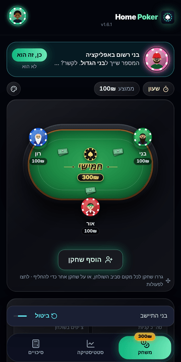
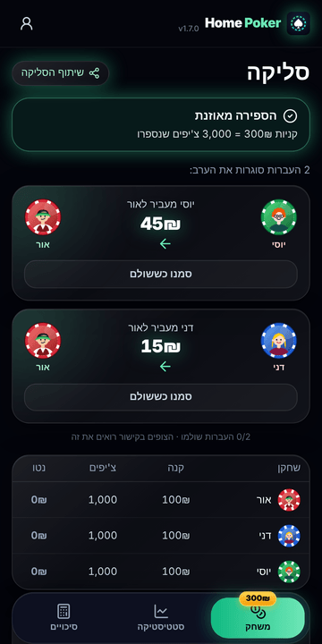
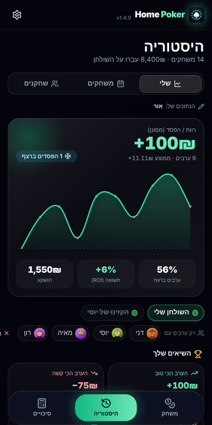
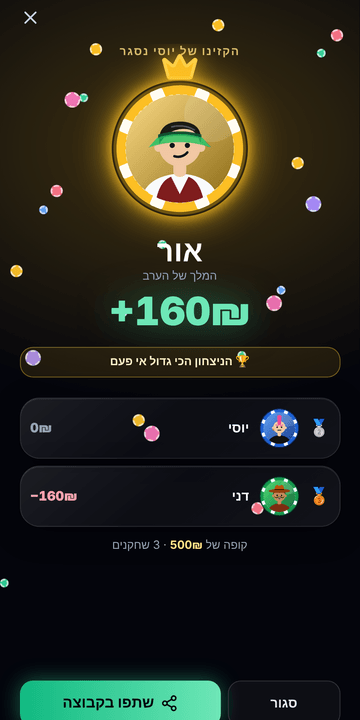
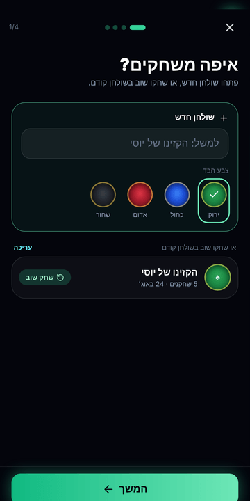
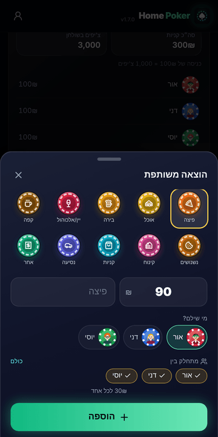
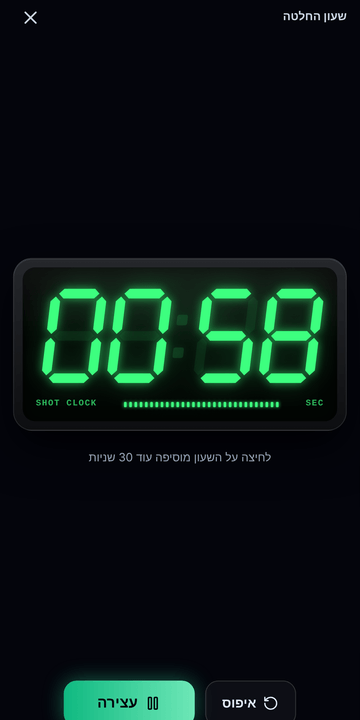
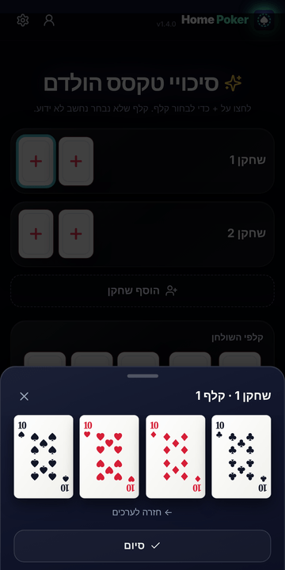

# 🃏 Home Poker

**Run your home poker night from your phone: buy-ins, chip count, minimal settlement, a live view for friends, and personal stats over time.**

**Live:** https://home-poker-il.netlify.app · **[עברית](README.he.md)**

---

Home Poker is an offline-first Progressive Web App for running home poker nights between friends. It tracks buy-ins and re-buys, checks the chip count, works out who pays whom with as few transfers as possible, streams the table live to friends who aren't there, and builds each player's long-term stats. Hebrew-first, right-to-left, designed for phones.

<p align="center">
  
  
  
  
</p>
<p align="center">
  
  
  
  
</p>

## Contents

- [Features](#features)
- [How it's built](#how-its-built)
- [Project structure](#project-structure)
- [Running locally](#running-locally)
- [Deploying](#deploying)
- [Cloud setup (Supabase)](#cloud-setup-supabase)
- [Push notifications](#push-notifications)
- [Privacy & security](#privacy--security)
- [Analytics](#analytics)
- [Releasing a new version](#releasing-a-new-version)

## Features

**At the table**
- **Tables, not groups:** every night belongs to a table with its own name and felt colour (green, blue, red or black). *Play again* re-seats the same players with the same buy-in in one tap. The players from the last night are suggested when you open a new table.
- **Players:** each player gets a character and a casino-chip frame. Drag players around the table to change seats. A bigger pile of banknotes (and a sweating character) shows who has bought in the most.
- **Buy-ins and re-buys** with a scroll wheel, the night's average buy-in, and a full **night log** (who sat down, every re-buy, who left, who paid for the pizza).
- **Undo:** every table action (re-buy, removal, seat move, expense) can be undone for 5 seconds.
- **Pick from contacts:** name + phone straight from the phone's contact picker (Android Chrome).
- **Shot clock:** a full-screen green LED clock with a scroll wheel for the time. Tap it to add another period, it ticks in the last 5 seconds, and a buzzer sounds at zero.
- **Odds calculator:** Texas Hold'em equity by Monte Carlo simulation (60,000 deals), with real-looking playing cards and a two-tap value → suit picker.

**Closing the night**
- **Chip count** with a live remainder bar and a zero-sum check. Once every chip is accounted for, the uncounted players get 0 automatically.
- **Settlement:** a greedy algorithm that settles everyone in at most *n − 1* transfers, with a *paid* mark on each transfer. The WhatsApp summary lists every transfer and the winners' phone numbers for Bit/PayBox.
- **Couples mode:** players who share a wallet keep separate seats, buy-ins and stats, but settle as one entity ("Danny & Dana"), so they never pay each other.
- **Shared expenses** (pizza, drinks, snacks…) with chip-style icons. The payer is owed and the rest split it. Expenses go into the transfers but never into the poker stats.
- **Winner screen** with podium, records broken ("biggest win ever", "3 wins in a row") and a share button.
- A gentle **"still playing?" nudge** for nights open more than 8 hours.

**Friends & stats**
- **Live view link:** a read-only page that updates after every change, with an invitation to sign up. It works offline too, as a snapshot link that carries the state inside the URL.
- **Personal dashboard:** a profit/loss curve (green above zero, red below), instant filters by table and by opponent, personal records, and head-to-head with an overlap index and smart tags (*Your ATM*, *Kryptonite*, *The Shark*…).
- **History:** rename nights and tables, move a night to another table, and multi-select delete.

**Optional cloud (Supabase)**
- Google sign-in, a custom character and glow colour visible to everyone, and shared tables with invite codes and a leaderboard.
- Every night saved while signed in syncs automatically into everyone's stats.
- **Phone linking:** when a host seats a registered player by phone number, the seat picks up that player's character and stats and they get an invite to the live view. Someone who joins later taps *"this is me"* and their earlier nights become theirs.
- **Invites:** an in-app pop-up when you've been seated in a live game, plus Web Push.
- **Backup of the open game:** if the host's phone dies, the night can be restored from any device.

## How it's built

| Layer | Choice | Why |
|---|---|---|
| UI | React 18 + Vite 5 | Fast builds, simple component model |
| Styling | Tailwind CSS 3, Rubik font | RTL-friendly utility classes |
| Motion | framer-motion | Drag-to-seat, sheets, micro-interactions |
| Icons | lucide-react + hand-made SVG (characters, chips, cards, 7-segment digits) | Look identical on every phone; no emoji fonts |
| Offline | Service Worker + `localStorage` | The whole app works with no network and no account |
| Cloud | Supabase (Postgres, Auth, RLS, RPC, Edge Functions) | Optional, lazy-loaded only when used |
| Analytics | PostHog (EU) | Anonymous product events, opt-out in settings |
| Hosting | Netlify | Static hosting, HTTPS, deploys from GitHub |

**Design decisions worth knowing**
- **Local-first:** the device is the source of truth. The saved history *is* the upload queue: a night saved offline syncs when the network returns. Uploads are idempotent, keyed by the client-generated game id, so retries never duplicate.
- **The cloud costs nothing until it's used:** without the env keys no cloud code is even downloaded, and with them the Supabase SDK loads only after sign-in.
- **Settlement maths in integer cents**, so there are no rounding errors. Any residue goes to the largest balance. Expenses and couples are folded in *before* the greedy pass.
- **No SMS:** history moves to a new account through an explicit *"this is me"* claim inside a table you belong to, so it stays free and can't be hijacked by typing someone's number.
- **Anti-flicker on Android:** no `backdrop-filter`, no screen-level entrance animations, no splash screen.

## Project structure

```
public/
  sw.js                  Service worker: offline cache + push notifications (bump VERSION each release)
  manifest.webmanifest   Install settings (name, colours, icons, RTL)
  privacy.html           Privacy policy (Hebrew)
  icons/, logo.svg       App icons (regenerate with `npm run icons`)
src/
  main.jsx               Entry: the main app, or the read-only viewer for ?view= / #snap= links
  App.jsx                Shell: header, bottom tabs, undo toast, celebration, haptics
  state/
    store.js             State shape, reducer, persistence & migrations, zero-sum check,
                         settlement (couples + expenses), player stats
    stats.js             Dashboard engine: nights from device + cloud, records, head-to-head, tags
  lib/                   poker.js (hand evaluator + Monte Carlo), phone.js (E.164 + SHA-256),
                         contacts.js, analytics.js, haptics.js, hints.js, link.js
  components/            PokerTable, DraggableSeat, CardFace, ShotClock, Dashboard, Expenses,
                         Celebration, Engagement (onboarding, push prompt, invite pop-up),
                         Avatar, WheelPicker, ui
  screens/               HomeScreen (lobby + new-game wizard), GameScreen (table, count, settlement),
                         HistoryScreen, OddsCalculator, CloudScreen (profile, tables), ViewerApp
  cloud/                 client.js (lazy SDK), CloudProvider.jsx (auth, sync, backup, invites),
                         sync.js, live.js, push.js, config.js
supabase/
  schema.sql             Tables, RLS policies and RPCs (run first)
  002_tables_profiles.sql  Felt colours, glow colour, open-game backup
  003_phones_invites_push.sql  Phone linking, invites, push subscriptions, "this is me"
  functions/notify-game/ Edge Function that sends Web Push
tests/core.test.mjs      Unit tests: zero-sum, settlement, couples, expenses, stats, odds, phones
docs/screenshots/        Images for this README
```

## Running locally

Requires Node 20+.

```bash
npm install
npm run dev       # http://localhost:5173
npm test          # unit tests (node:test)
npm run lint      # ESLint
npm run build     # production build → dist/
npm run preview   # serve the build, including the service worker
```

With no env file at all, the app runs fully local: no cloud, no analytics. To use the cloud locally, copy `.env.example` to `.env.local` and fill it in.

## Deploying

The site is hosted on **Netlify** and builds from this repository (see `netlify.toml`): `npm ci && npm test && npm run build`, publishing `dist/`. A failing test stops the deploy.

Build-time settings live in **`.env.production`**. Every value there is public by design (Supabase anon key, PostHog project key, VAPID *public* key), because they end up in the browser bundle anyway. Secrets never go in the repo: the Supabase `service_role` key, the VAPID private key and OAuth client secrets live only in Supabase.

## Cloud setup (Supabase)

1. Create a Supabase project (EU region).
2. **SQL Editor:** run `supabase/schema.sql`, then `002_tables_profiles.sql`, then `003_phones_invites_push.sql`. All three are safe to re-run.
3. **Authentication → Providers → Google:** create an OAuth "Web" client in Google Cloud with the redirect URI `https://<project>.supabase.co/auth/v1/callback`.
4. **Authentication → URL Configuration:** set Site URL and Redirect URLs to the site address.
5. Put the Project URL and the anon key in `.env.production`.

Sign-in with an emailed code is off by default, because Supabase's built-in mailer only sends to team members. Configure custom SMTP and build with `VITE_AUTH_EMAIL=1` to enable it.

## Push notifications

Optional. Without them, invited players still get the in-app pop-up when they open the app.

1. **Edge Functions:** deploy `supabase/functions/notify-game/index.ts` as `notify-game`.
2. **Edge Functions → Secrets:** add `VAPID_PUBLIC_KEY`, `VAPID_PRIVATE_KEY` and `VAPID_SUBJECT` (`mailto:you@example.com`).
3. Put the same public key in `.env.production` as `VITE_VAPID_PUBLIC_KEY`.

On iPhone, push works only after the app is added to the Home Screen (iOS 16.4+).

## Privacy & security

- **Row Level Security everywhere:** only members of a table can read its nights, and every write goes through `security definer` functions that check membership.
- **Phone numbers never reach the server:** the app sends a SHA-256 hash of the E.164 number, stored in tables with no read policy at all. Lookups are rate limited (40/hour), return only a name and character, and the host confirms *"is this them?"* before anything is linked.
- **Contacts:** the app uses the system contact picker. It never sees the address book, only the contacts the user ticks (name and phone), and those stay on the device.
- **Live links** contain names and amounts only, with no ids or history, and expire after two days.
- **Analytics are anonymous:** no names, amounts or chip counts, and users can opt out in settings.

## Analytics

Anonymous PostHog events, sent only when `VITE_POSTHOG_KEY` is set. The main ones are `game_started`, `player_added`, `game_saved`, `settlement_shared`, `live_link_created`, `live_viewed`, `viewer_cta_clicked`, `cloud_signed_in`, `player_invited`, `player_claimed`, `odds_calculated` and `app_installed`. The best health metrics are weekly retention on `game_saved`, and the funnel `game_started → player_added → game_saved`.

## Releasing a new version

1. Bump `"version"` in `package.json`; it shows in the app header.
2. Bump `VERSION` in `public/sw.js` (for example `hpm-v34`) so installed phones pick up the update.
3. Run `npm test && npm run lint`, then commit and push. Netlify builds and deploys automatically.

---

© Or Smolarchik. All rights reserved.
